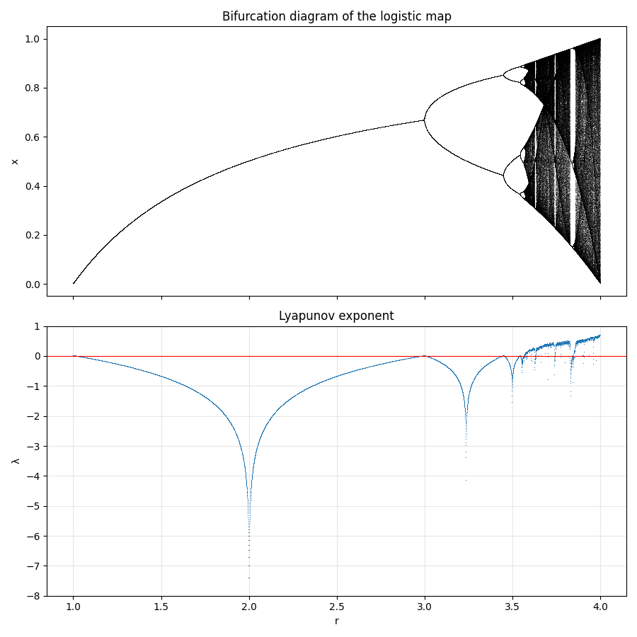
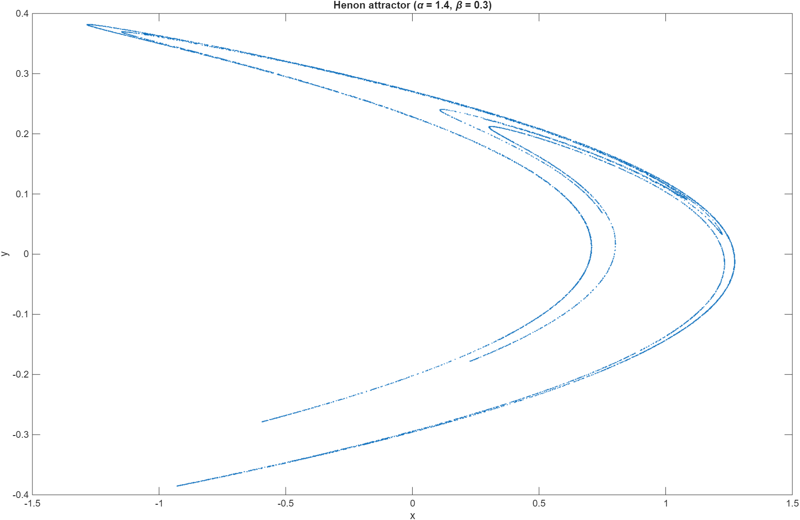
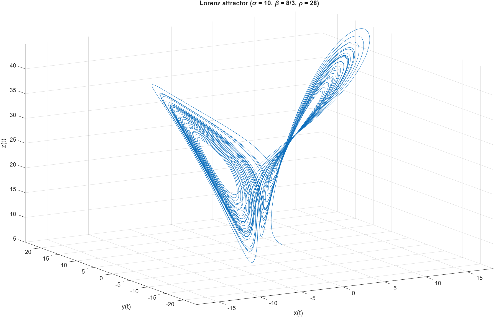
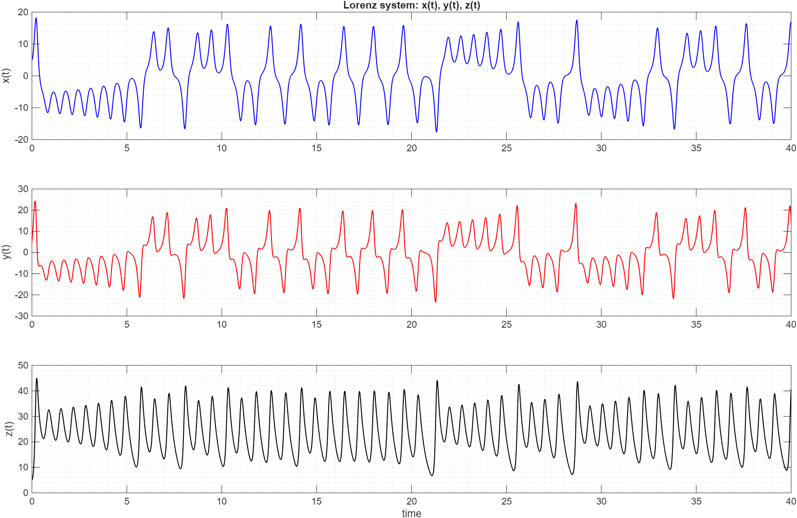
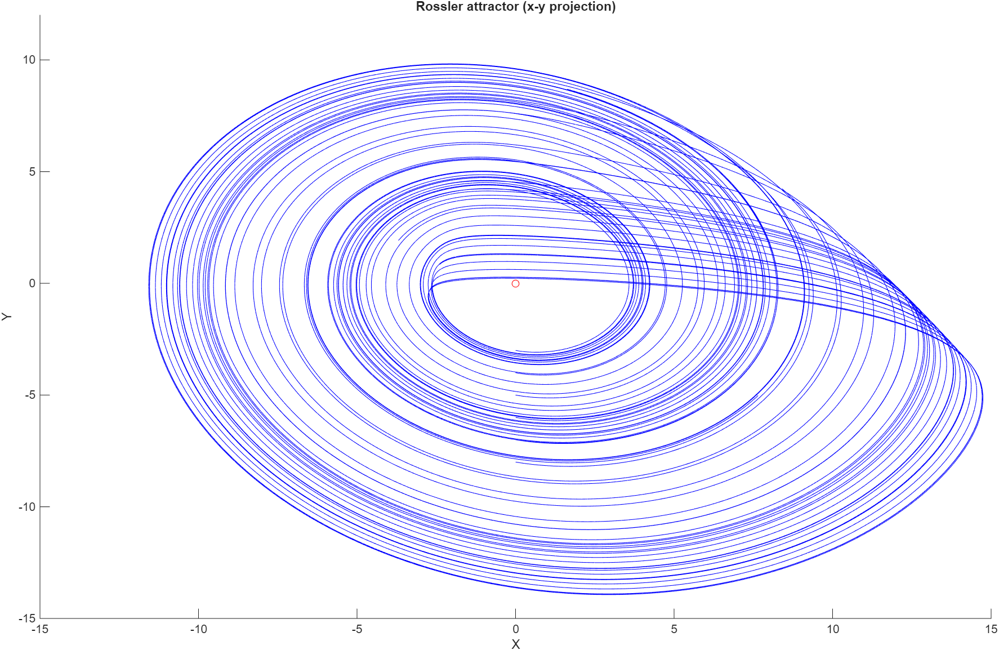

# Chaotic Systems: Logistic Map, Hénon Map, Lorenz & Rössler Attractors

Numerical exploration of four classic nonlinear dynamical systems: two discrete maps and two
continuous flows. Coursework for *Evaluation of Chaotic Systems*, BSc Physics,
Democritus University of Thrace (2023).

| System | File | Method |
|---|---|---|
| Logistic map | `logistic_map.py` | iteration, bifurcation diagram, Lyapunov exponent |
| Hénon map | `henon.m` | iteration |
| Lorenz attractor | `lorenz.m` | ODE integration (`ode45`) |
| Rössler attractor | `rossler.m` | ODE integration (explicit Euler) |

## Logistic map: bifurcations and Lyapunov exponent

$$x_{n+1} = r x_n(1 - x_n)$$

The map is iterated for 10,000 values of $r \in [1, 4]$. After discarding the transient, the iterates
form the **bifurcation diagram**, and the average of $\log|r(1 - 2x_n)|$ along the orbit gives the
**Lyapunov exponent** $\lambda$.



- **r < 3:** a single stable fixed point ($\lambda < 0$).
- **3 < r < ~3.57:** period-doubling cascade (2, 4, 8, … cycles); $\lambda$ touches 0 at each bifurcation.
- **r > ~3.57:** chaos ($\lambda > 0$), interrupted by periodic windows (e.g. the period-3 window near
  r ≈ 3.83) where $\lambda$ drops below zero again.

## Hénon map

$$x_{n+1} = 1 + y_n - \alpha x_n^2, \qquad y_{n+1} = \beta x_n, \qquad \alpha = 1.4,\ \beta = 0.3$$

A two-dimensional map that repeatedly stretches and folds the plane. With the classic parameters the
orbit settles onto a strange attractor with a fractal, layered structure.



## Lorenz attractor

$$\dot{x} = \sigma(y - x), \qquad \dot{y} = x(\rho - z) - y, \qquad \dot{z} = xy - \beta z,
\qquad \sigma = 10,\ \beta = 8/3,\ \rho = 28$$

Integrated with MATLAB's `ode45`. The trajectory switches irregularly between two lobes, the
"butterfly", and never repeats.



The time series show the same behaviour from another angle: x(t) and y(t) oscillate around one
lobe for an unpredictable number of turns, then jump to the other (sign change).



## Rössler attractor

$$\dot{x} = -y - z, \qquad \dot{y} = x + a y, \qquad \dot{z} = b + z(x - c), \qquad a = b = 0.2,\ c = 7$$

Integrated with the explicit Euler method from several initial conditions; all trajectories converge
onto the same chaotic attractor (x–y projection shown).



## Nonlinear time-series analysis

The [`time-series-analysis`](time-series-analysis/) folder goes the other way: starting from a
measured scalar time series, it reconstructs the attractor by delay embedding and estimates its
correlation dimension, largest Lyapunov exponent and entropy with TISEAN.

## Run

```
pip install -r requirements.txt
python logistic_map.py
```

The `.m` scripts run in MATLAB (or GNU Octave) from the repository folder and save their main figure
to `figures/`.
