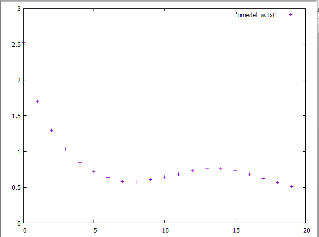
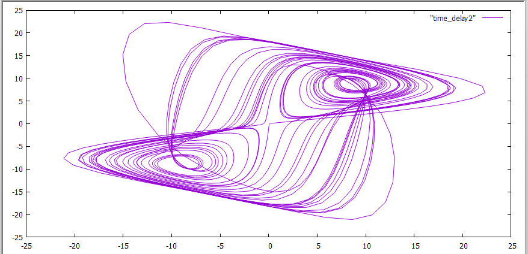
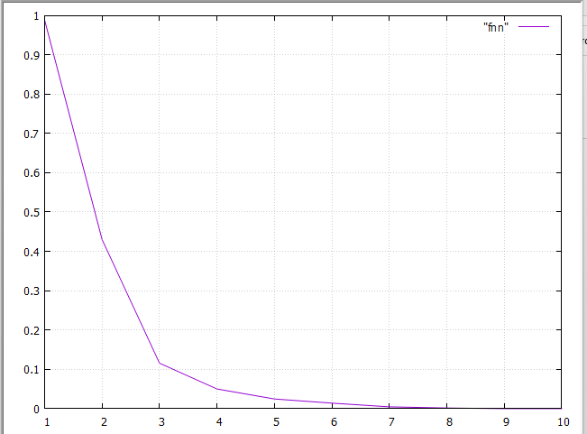
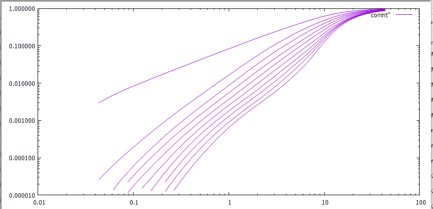
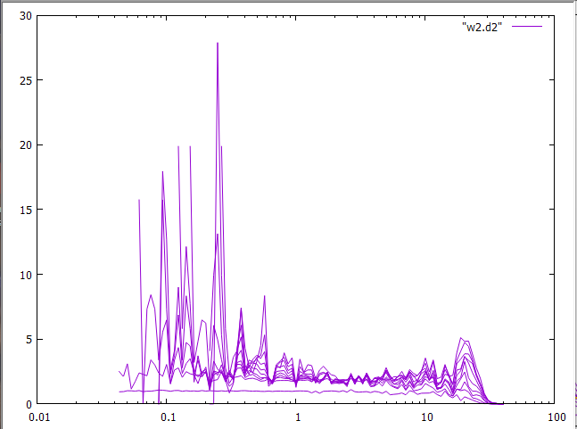
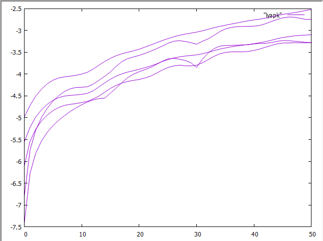
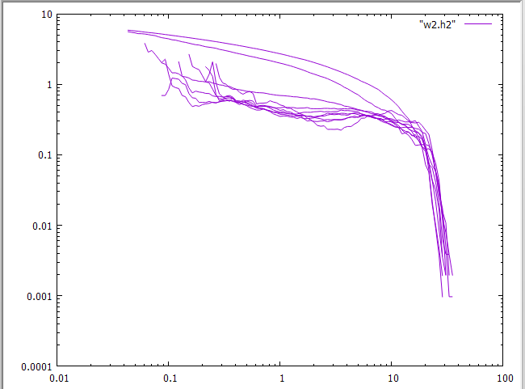

# Nonlinear Time-Series Analysis with TISEAN

Analysis of a scalar time series (`w2.txt`, 2000 samples, provided by the course) to reconstruct its
attractor and characterise it with dimension, Lyapunov and entropy estimates. All computations were
done with TISEAN 3.0 (Hegger, Kantz & Schreiber) and plotted with
gnuplot.

- `run_tisean.bat`: the TISEAN commands, in the order they were run
- `plots.gnu`: the gnuplot commands used to plot the output files
- `w2.txt`: the time series
- `figures/`: the resulting plots

## 1. Delay time

The time-delayed mutual information has its first minimum at a lag of **8 samples**, so **τ = 8**
is used for the delay embedding. The mutual information is preferred over the autocorrelation
because it also captures nonlinear dependence.



## 2. Attractor reconstruction

Delay vectors $(x_t,\ x_{t-\tau})$ give the phase portrait of the reconstructed attractor, a
two-lobed structure.



## 3. Embedding dimension (false nearest neighbours)

The fraction of false nearest neighbours drops sharply with the embedding dimension m: it is
below about 5% at m = 4–5 and practically zero from m ≈ 7–8 onwards. An embedding dimension of
about 5 is therefore sufficient, which is consistent with Takens' condition $m > 2D_2$ for the
dimension estimated below.



## 4. Correlation dimension

Correlation sums $C(\varepsilon)$ were computed for embedding dimensions 1–10 and smoothed into
Gaussian kernel correlation integrals. For a fractal attractor $C(\varepsilon) \sim \varepsilon^{D_2}$,
so the dimension is read from the local slopes $d\ln C / d\ln\varepsilon$.



The local slopes form a plateau at intermediate scales, giving a correlation dimension of
**$D_2 \approx 1.8$**. At small ε the estimate is dominated by noise (too few pairs), and at large ε
it falls off as ε approaches the size of the attractor.



## 5. Maximal Lyapunov exponent

`lyap_k` (Kantz algorithm) computes the average stretching $S(\Delta n)$ of initially close
trajectories for several embedding dimensions and neighbourhood sizes. The slope of the initial
linear increase estimates the **largest** Lyapunov exponent; the positive slope indicates
sensitive dependence on initial conditions, i.e. chaos.



## 6. Correlation entropy

`d2` also returns the order-2 (correlation) entropy $K_2$. Its plateau at intermediate scales gives
**$K_2 \approx 0.4$ per sampling step**. $K_2$ is a lower bound of the Kolmogorov–Sinai entropy,
which by Pesin's identity equals the sum of the positive Lyapunov exponents.



## Reproduce

```
run_tisean.bat     # needs TISEAN on the PATH and w2.txt in this folder
```

Then plot the output files with the commands in `plots.gnu`.

## Summary

| Quantity | Estimate |
|---|---|
| Delay time τ | 8 samples |
| Sufficient embedding dimension | m ≈ 5 (FNN ≈ 0 from m ≈ 7–8) |
| Correlation dimension $D_2$ | ≈ 1.8 |
| Largest Lyapunov exponent | positive (chaotic) |
| Correlation entropy $K_2$ | ≈ 0.4 per sampling step |

Coursework for *Evaluation of Chaotic Systems*, BSc Physics, Democritus University of Thrace
(2022–2023).
